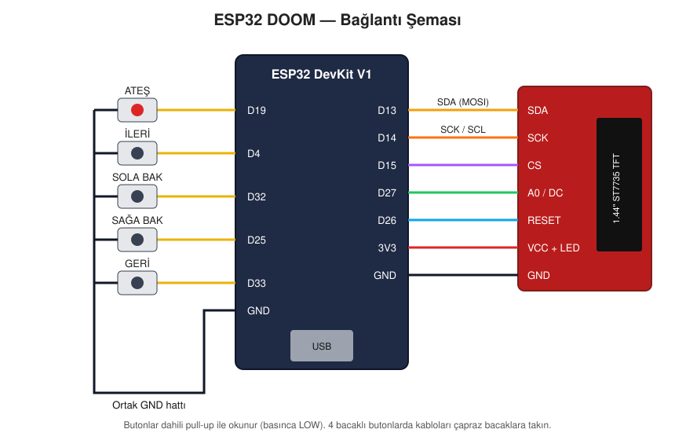

# ESP32 DOOM

A **Doom-style raycaster** game written from scratch, running on an ESP32 DevKit V1 and a 1.44" 128x128 color TFT display. The game is played with 5 buttons, and the only external library used is [TFT_eSPI](https://github.com/Bodmer/TFT_eSPI).

> This project is not a port of id Software's Doom. All graphics (textures, enemy, weapon) are generated procedurally in code; no WAD file or original game data is used.

## Features

- Wolfenstein/Doom-style raycasting engine, ~80 FPS (240 MHz)
- 3 different procedural wall textures (brick, metal panel, stone) with distance-based shading
- Sprite enemies hidden behind walls via a Z-buffer
- 8 enemies that chase the player on sight and attack in melee
- Weapon bob while walking, muzzle flash, and a red border when taking damage
- HUD: health, ammo, kill count
- Title, death, and level-complete screens

## Hardware

| Part | Qty |
|---|---|
| ESP32 DevKit V1 (ESP32-WROOM-32) | 1 |
| 1.44" 128x128 SPI TFT display (ST7735) | 1 |
| Tactile button | 5 |
| Breadboard and jumper wires | — |

## Wiring Diagram



### Display

| Display pin | ESP32 |
|---|---|
| SDA (MOSI) | D13 |
| SCK / SCL | D14 |
| CS | D15 |
| A0 / DC | D27 |
| RESET | D26 |
| VCC | 3V3 |
| LED / BL | 3V3 |
| GND | GND |

> The display is labeled SDA/SCL, but it is an **SPI** display. It must **not** be connected to the I2C pins (D21/D22).

### Buttons

One side of each button connects to an ESP32 pin, the other side to GND. The code uses the internal pull-ups, so no external resistors are needed.

| Button | ESP32 |
|---|---|
| Fire | D19 |
| Move forward | D4 |
| Turn left | D32 |
| Turn right | D25 |
| Move backward | D33 |

> **Note:** On 4-leg buttons, the legs are connected internally in pairs. Wire to **diagonally opposite** legs, otherwise the button will read as permanently pressed.

## Setup

[PlatformIO](https://platformio.org/) is required. On Debian/Ubuntu:

```bash
# PlatformIO
sudo apt install python3-venv
curl -fsSL -o get-platformio.py https://raw.githubusercontent.com/platformio/platformio-core-installer/master/get-platformio.py
python3 get-platformio.py
echo 'export PATH="$PATH:$HOME/.platformio/penv/bin"' >> ~/.bashrc && source ~/.bashrc

# Serial port permission (log out and back in afterwards)
sudo usermod -aG dialout $USER
```

Build and upload:

```bash
git clone https://github.com/FredJones35/esp32doom.git
cd esp32doom
pio run -t upload        # or ./flash-game.sh
pio device monitor       # FPS output
```

All TFT_eSPI settings are provided through `build_flags` in `platformio.ini`, so there is no need to edit the library's `User_Setup.h`.

## Controls

| Button | Action |
|---|---|
| Fire | Shoot (hold for auto-fire) / start the game / restart |
| Forward / Backward | Walk |
| Turn left / right | Rotate |

The level is complete when you kill all the enemies. Each enemy killed gives +4 ammo.

## Troubleshooting

| Symptom | Fix |
|---|---|
| Screen is completely white | Wiring error. Check the SDA→D13 and SCK→D14 connections. If `FPS:` shows up in the serial monitor, the code is running. |
| Image is shifted by 32 pixels or has a snowy strip at the top | Change the driver setting in `platformio.ini`: `ST7735_GREENTAB3` → `GREENTAB128` / `GREENTAB2` / `BLACKTAB` |
| 1–2 pixel colored line at the edge | Try `ST7735_GREENTAB2` or `ST7735_BLACKTAB` |
| Red and blue are swapped | Enable the `-D TFT_RGB_ORDER=TFT_BGR` line |
| Image is garbled or snowy | Set `SPI_FREQUENCY` to `20000000` or `10000000` |
| Fire button fires continuously without being pressed | Button legs are wired wrong; use diagonally opposite legs. Also make sure the `TFT_MISO=-1` setting is in place (D19 is normally the VSPI MISO pin). |
| Upload fails with `Unable to verify flash chip connection` | A wire may be connected to D12 or to the CMD/SD0–SD3/CLK pins. These pins must be left unconnected. |

## Project Structure

```
esp32doom/
├── platformio.ini     # board, library and display settings
├── flash-game.sh      # build + upload shortcut
├── src/
│   └── main.cpp       # game: raycaster, enemies, HUD, input
└── docs/
    └── wiring.svg     # wiring diagram
```

## How It Works

- **Rendering:** For each screen column, a ray is cast in the player's viewing direction. The ray advances through the 16x16 map grid using the DDA algorithm. The column height and texture coordinate are computed from the distance at which it hits a wall.
- **Framebuffer:** The 128x128 RGB565 image (32 KB) is drawn into a `TFT_eSprite` in RAM and sent to the display over SPI in a single transfer each frame.
- **Sprites:** Enemies are transformed into camera space, sorted far to near, and drawn column by column, clipped against the Z-buffer.
- **Textures:** Generated at startup as 32x32 images using hash-based noise; no image files are stored in flash.
